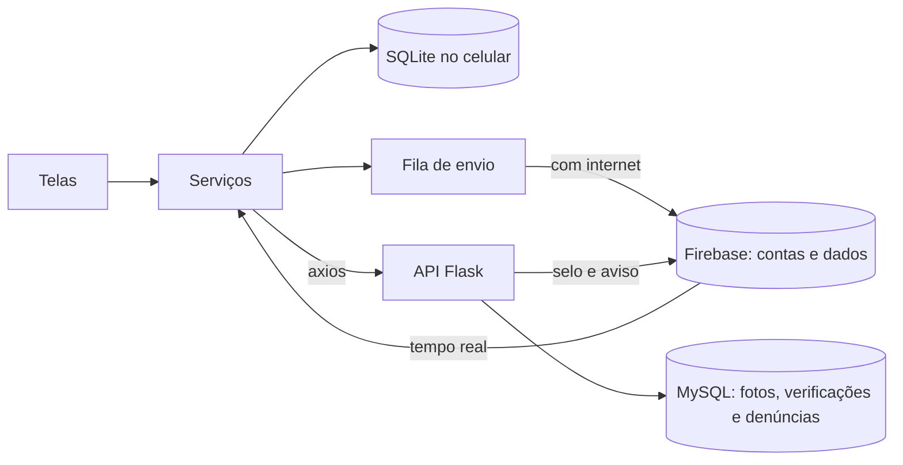

# InfoAbrigo

Aplicativo híbrido que aproxima quem quer ajudar dos abrigos de crianças e adolescentes da região: mostra os abrigos no mapa, o que cada um precisa hoje e como doar, e organiza visitas e entregas numa agenda.

Trabalho da disciplina **Laboratório de Desenvolvimento de Aplicativos Híbridos**, Engenharia de Software, Universidade de Vassouras (2026/2).

## O que tem aqui

| Pasta ou arquivo | O que é |
|---|---|
| `src/` | O aplicativo: React Native com Expo SDK 58, em JavaScript |
| `database.rules.json` | As regras de segurança do banco no Firebase |
| `backend/` | A API REST: Python, Flask e MySQL, com Swagger e Docker |
| `__tests__/` | Testes do aplicativo e das regras do Firebase, com Jest |
| `backend/tests/` | Testes da API, com pytest |
| `docs/` | Um documento por módulo, com o conceito da aula aplicado e como testar |

## Os exemplos da disciplina no projeto

| Exemplo | Onde está no InfoAbrigo |
|---|---|
| `LPAH-Biometria` | `src/components/BiometricButton.js` |
| `LPAH-20221-MAP_GPS` | `src/screens/MapScreen.js`. O GPS é igual; o mapa usa Leaflet (veja `docs/modulo-04-mapa.md`) |
| `LPAH-20221-Camera` | `src/components/CameraFoto.js` e `src/services/galeria.js` |
| `async-storage` | `src/services/auth.js` e `src/services/avisos.js` |
| `LPAH-2024-SQLITE` | `src/services/bancoLocal.js` |
| `LPAH-2024-Firebase` | `src/services/firebase.js` e `src/services/bancoRemoto.js` |
| `LPAH-2026-SQLITE-FIREBASE` | `src/services/sincronizacao.js`, com fila e NetInfo |
| `API-Tasks` | `backend/` |
| `Task-Manager-API` | `src/services/api.js` e `src/services/servicosApi.js`, com axios |

## Como funciona

As telas leem e gravam no banco SQLite do celular. Cada alteração entra numa fila, que vai para o Firebase quando há conexão, e o que mudou nos outros celulares chega em tempo real. Por isso o aplicativo continua funcionando sem internet.

A API cuida do que o aplicativo não pode decidir sozinho, e do que o plano gratuito do Firebase não oferece.



| Quem | Responde por |
|---|---|
| **Firebase Authentication** | Contas, senhas e recuperação de senha por e-mail |
| **Firebase Realtime Database** | Abrigos, necessidades, doações e agenda |
| **SQLite** | Cópia no celular, para funcionar sem internet |
| **API + MySQL** | Fotos, selo de instituição verificada, recomendações, painel do gestor e denúncias |

As permissões do banco estão nas regras do Firebase: só o dono altera o abrigo, só quem administra marca uma entrega, doações e agenda são privadas, e o selo só pode ser escrito pela API. Os detalhes estão em [docs/modulo-11-servidor-e-banco.md](docs/modulo-11-servidor-e-banco.md).

## Como rodar

São precisos o [Node.js](https://nodejs.org) 22 ou mais novo e o aplicativo **Expo Go** atualizado no celular.

### Só o aplicativo

Sem o `.env`, os dados ficam só no celular.

```bash
npm install
```

```bash
npx expo start
```

Abra o QR Code no Expo Go.

### Com o Firebase e a API

1. Crie o projeto no [console do Firebase](https://console.firebase.google.com), como explica o [guia de publicação](docs/modulo-12-recursos-nativos-e-publicacao.md).
2. Copie o `.env.example` para `.env` e preencha as chaves.
3. Suba a API, com o [README dela](backend/README.md).
4. Rode `npx expo start` de novo.

Para testar sem criar um projeto, é possível usar o emulador do Firebase, que precisa do Java. O `.env.example` mostra como.

```bash
npm install -g firebase-tools
```

```bash
npm run emulador
```

## Testes

```bash
npm test
```

Os testes de sincronização e das regras de segurança ficam de fora, a menos que o emulador esteja no ar e a variável `TESTE_FIREBASE=1` esteja definida.

Testes da API, com o MySQL e o emulador no ar:

```bash
cd backend && python -m pytest tests
```

## Publicação

O passo a passo está em [docs/modulo-12-recursos-nativos-e-publicacao.md](docs/modulo-12-recursos-nativos-e-publicacao.md).

## Limites conhecidos

- **Mapa:** usa Leaflet com WebView, e não `react-native-maps`, que deu tela preta no Expo Go (veja `docs/modulo-04-mapa.md`).
- **Expo Go:** badge, lembretes e o calendário nativo só funcionam no aplicativo instalado por build próprio. No Expo Go o aplicativo abre normalmente, sem badge nem lembrete, e o botão de calendário abre a Agenda do Google.
- **Sem a API no ar:** contas e dados continuam funcionando. Selo, recomendações, painel e denúncias ficam indisponíveis, e as fotos novas ficam guardadas em texto junto do abrigo.
- **Pagamento:** o aplicativo monta o código Pix, mas quem paga é o banco da pessoa. Nada confere se o pagamento aconteceu.
- **Selo:** prova que a instituição existe e está ativa, não que a pessoa trabalha lá. Isso exigiria revisão de documentos.
- **Fotos:** só a foto do abrigo sai do celular. As fotos de registro da agenda e a foto de perfil ficam no aparelho em que foram tiradas.
- **Mais de uma conta no celular:** o Firebase mantém uma sessão por vez. Quem entra pela digital em outra conta precisa entrar uma vez com a senha para sincronizar.
- **Plano gratuito do Firebase:** 100 conexões simultâneas, 1 GB guardado e 10 GB baixados por mês.
- **Serviços públicos:** CEP, CNPJ, mapa e rota dependem de serviços gratuitos de terceiros (BrasilAPI, OpenStreetMap, Esri e Valhalla), sem garantia de disponibilidade.
