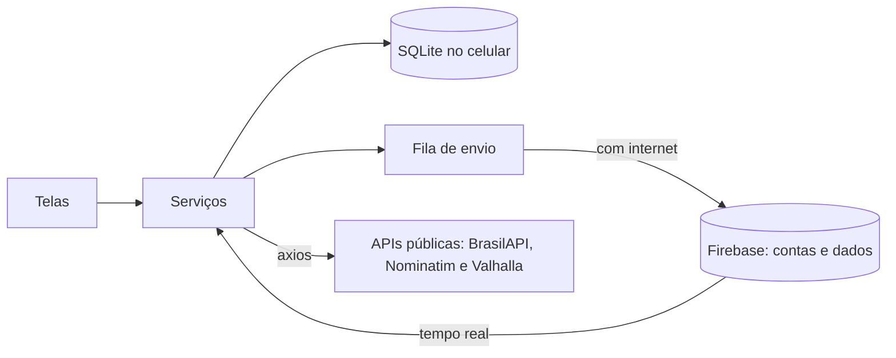

# InfoAbrigo

Aplicativo híbrido que aproxima quem quer ajudar dos abrigos de crianças e adolescentes da região: mostra os abrigos no mapa, o que cada um precisa hoje e como doar, e organiza visitas e entregas numa agenda.

Trabalho da disciplina **Laboratório de Desenvolvimento de Aplicativos Híbridos**, Engenharia de Software, Universidade de Vassouras (2026/2).

## O que tem aqui

| Pasta ou arquivo | O que é |
|---|---|
| `src/` | O aplicativo: React Native com Expo SDK 58, em JavaScript |
| `database.rules.json` | As regras de segurança do banco no Firebase |
| `backend/` | O exemplo `API-Tasks` da disciplina: API REST em Python, Flask e MySQL, com Swagger e Docker. O aplicativo não depende dela |
| `__tests__/` | Testes do aplicativo e das regras do Firebase, com Jest |
| `backend/tests/` | Testes da API, com pytest |
| `docs/` | Um documento por módulo, com o conceito da aula aplicado e como testar |

## Os exemplos da disciplina no projeto

| Exemplo | Onde está no InfoAbrigo |
|---|---|
| `LPAH-Biometria` | `src/components/BiometricButton.js` |
| `LPAH-20221-MAP_GPS` | `src/screens/MapScreen.js`. O GPS é igual; o mapa usa Leaflet (veja `docs/modulo-04-mapa.md`) |
| `LPAH-20221-Camera` | `src/components/CameraFoto.js` e `src/services/galeria.js` |
| `async-storage` | `src/services/auth.js` e `src/services/avisos.js` |
| `LPAH-2024-SQLITE` | `src/services/bancoLocal.js` |
| `LPAH-2024-Firebase` | `src/services/firebase.js` e `src/services/bancoRemoto.js` |
| `LPAH-2026-SQLITE-FIREBASE` | `src/services/sincronizacao.js`, com fila e NetInfo |
| `API-Tasks` | `backend/`, como exemplo à parte (veja abaixo) |
| `Task-Manager-API` | `src/services/api.js`: o cliente axios das APIs públicas (BrasilAPI, Nominatim e Valhalla) |
| `Exemplos de Teste App` | Jest em `__tests__/` e Maestro em `maestro/` |

## Como funciona

As telas leem e gravam no banco SQLite do celular. Cada alteração entra numa fila, que vai para o Firebase quando há conexão, e o que mudou nos outros celulares chega em tempo real. Por isso o aplicativo continua funcionando sem internet.

O aplicativo não depende de servidor próprio: o banco é o Firebase, e as APIs que ele consome com axios são públicas e já estão na internet. Por isso ele funciona em qualquer lugar, sem computador ligado.



| Quem | Responde por |
|---|---|
| **Firebase Authentication** | Contas, senhas e recuperação de senha por e-mail |
| **Firebase Realtime Database** | Abrigos, necessidades, doações, agenda, selo, denúncias e fotos |
| **SQLite** | Cópia no celular, para funcionar sem internet |
| **BrasilAPI** | Endereço pelo CEP e situação do CNPJ na Receita, para o selo |
| **Nominatim e Valhalla** | Coordenada do endereço e rota até o abrigo |

Recomendações e painel do gestor são calculados no próprio celular, com os dados que já vieram do Firebase.

As permissões do banco estão nas regras do Firebase: só o dono altera o abrigo, só quem administra marca uma entrega, doações e agenda são privadas, o selo só entra pelo dono do abrigo e com um CNPJ que nenhuma outra conta usou, e cada pessoa denuncia um abrigo uma vez só. Os detalhes estão em [docs/modulo-11-servidor-e-banco.md](docs/modulo-11-servidor-e-banco.md).

### A pasta `backend/`

É o exemplo `API-Tasks` da disciplina aplicado ao InfoAbrigo: Flask, MySQL, Swagger em `/apidocs`, Docker e exclusão lógica. Ela continua no repositório, com os testes dela, para mostrar esse conteúdo. O aplicativo deixou de depender dela porque uma API própria só funciona com um servidor ligado, e o trabalho precisa rodar em qualquer lugar.

## Como rodar

São precisos o [Node.js](https://nodejs.org) 22 ou mais novo e o aplicativo **Expo Go** atualizado no celular.

### Só o aplicativo

Sem o `.env`, os dados ficam só no celular.

```bash
npm install
```

```bash
npx expo start
```

Abra o QR Code no Expo Go.

### Com o Firebase

1. Crie o projeto no [console do Firebase](https://console.firebase.google.com), como explica o [guia de publicação](docs/modulo-12-recursos-nativos-e-publicacao.md), e publique as regras de `database.rules.json`.
2. Copie o `.env.example` para `.env` e preencha as chaves.
3. Rode `npx expo start` de novo.

Para testar sem criar um projeto, é possível usar o emulador do Firebase, que precisa do Java. O `.env.example` mostra como.

```bash
npm install -g firebase-tools
```

```bash
npm run emulador
```

## Testes

```bash
npm test
```

O `--forceExit` do `npm test` existe porque o Realtime Database do Firebase deixa um temporizador de estatísticas ligado mesmo depois de fechado, e sem ele o Jest não termina.

Os testes de sincronização e das regras de segurança ficam de fora, a menos que o emulador esteja no ar e a variável `TESTE_FIREBASE=1` esteja definida.

### Testes de interface com o Maestro

Seguem o exemplo da disciplina: o Jest confere as regras, e o [Maestro](https://maestro.dev) usa o app como uma pessoa, tocando nos botões e conferindo o que aparece na tela.

| Fluxo | O que faz |
|---|---|
| `maestro/infoabrigo-basico.yaml` | Abre o app, confere a tela de entrada e abre o cadastro |
| `maestro/infoabrigo-cadastro.yaml` | Cria uma conta de doador e passa pelas abas |
| `maestro/infoabrigo-offline.yaml` | Liga o modo avião, marca um compromisso, confere a faixa "Aguardando conexão" e que ele é enviado quando a internet volta |
| `maestro/abrir-app.yaml` | Abre o projeto no Expo Go, do zero. Os outros dois fluxos usam este |

Para rodar:

1. Instale o Maestro, que precisa do Java.
2. Ligue a depuração USB no Android e conecte o celular no computador.
3. Deixe o `npx expo start` rodando.
4. Rode o comando abaixo, trocando o endereço pelo que o Expo mostra no terminal.

```bash
maestro test -e EXPO_URL=exp://192.168.18.124:8081 maestro/infoabrigo-basico.yaml maestro/infoabrigo-cadastro.yaml maestro/infoabrigo-offline.yaml
```

O `clearState` apaga os dados do Expo Go no celular antes de cada fluxo, como no exemplo do professor.

Em celulares Xiaomi, POCO e Redmi, ative também **Instalar via USB** e **Depuração USB (Configurações de segurança)** nas Opções do desenvolvedor. Esses celulares pedem confirmação a cada instalação do app auxiliar do Maestro. Depois de aceitar uma vez, rode com `--no-reinstall-driver` para não precisar aceitar de novo.

Testes do exemplo `backend/`, com o MySQL e o emulador no ar:

```bash
cd backend && python -m pytest tests
```

## Publicação

O aplicativo não será publicado nas lojas. O que a aula 16 pede para gerar o instalador está registrado em [docs/modulo-12-recursos-nativos-e-publicacao.md](docs/modulo-12-recursos-nativos-e-publicacao.md), só como referência.

## Limites conhecidos

- **Mapa:** usa Leaflet com WebView, e não `react-native-maps`. Desde o SDK 52, o Expo Go não mostra mais o Google Maps, e o mapa nativo só funcionaria num build próprio (veja `docs/modulo-04-mapa.md`).
- **Expo Go:** badge, lembretes e o calendário nativo só funcionam no aplicativo instalado por build próprio. No Expo Go o aplicativo abre normalmente, sem badge nem lembrete, e o botão de calendário abre a Agenda do Google.
- **Selo:** é conferido pelo próprio celular na BrasilAPI. As regras impedem que outra conta use o mesmo CNPJ ou dê selo a abrigo alheio, mas alguém que alterasse o aplicativo poderia gravar um selo para o próprio abrigo com um CNPJ inativo. Para impedir isso de vez, seria preciso um servidor.
- **Denúncias:** quem denuncia não aparece para ninguém no aplicativo, mas o banco guarda o identificador da conta, para cada pessoa denunciar uma vez só.
- **Pagamento:** o aplicativo monta o código Pix, mas quem paga é o banco da pessoa. Nada confere se o pagamento aconteceu.
- **Selo:** prova que a instituição existe e está ativa, não que a pessoa trabalha lá. Isso exigiria revisão de documentos.
- **Fotos:** só a foto do abrigo sai do celular. As fotos de registro da agenda e a foto de perfil ficam no aparelho em que foram tiradas.
- **Mais de uma conta no celular:** o Firebase mantém uma sessão por vez. Quem entra pela digital em outra conta precisa entrar uma vez com a senha para sincronizar.
- **Plano gratuito do Firebase:** 100 conexões simultâneas, 1 GB guardado e 10 GB baixados por mês.
- **Serviços públicos:** CEP, CNPJ, mapa e rota dependem de serviços gratuitos de terceiros (BrasilAPI, OpenStreetMap, Esri e Valhalla), sem garantia de disponibilidade.
