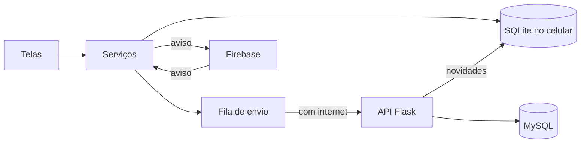

# InfoAbrigo

Aplicativo híbrido que aproxima quem quer ajudar dos abrigos de crianças e adolescentes da região: mostra os abrigos no mapa, o que cada um precisa hoje e como doar, e organiza visitas e entregas numa agenda.

Trabalho da disciplina **Laboratório de Desenvolvimento de Aplicativos Híbridos**, Engenharia de Software, Universidade de Vassouras (2026/2).

## O que tem aqui

| Pasta | O que é |
|---|---|
| `src/` | O aplicativo: React Native com Expo SDK 58, em JavaScript |
| `backend/` | A API REST: Python, Flask e MySQL, com Swagger e Docker |
| `__tests__/` | Testes do aplicativo, com Jest |
| `backend/tests/` | Testes da API, com pytest |
| `docs/` | Um documento por módulo, com o conceito da aula aplicado e como testar |

## Os exemplos da disciplina no projeto

| Exemplo | Onde está no InfoAbrigo |
|---|---|
| `LPAH-Biometria` | `src/components/BiometricButton.js` |
| `LPAH-20221-MAP_GPS` | `src/screens/MapScreen.js`. O GPS é igual; o mapa usa Leaflet (veja `docs/modulo-04-mapa.md`) |
| `LPAH-20221-Camera` | `src/components/CameraFoto.js` e `src/services/galeria.js` |
| `async-storage` | `src/services/auth.js` e `src/services/avisos.js` |
| `LPAH-2024-SQLITE` | `src/services/bancoLocal.js` |
| `API-Tasks` | `backend/` |
| `Task-Manager-API` | `src/services/api.js`, com axios |
| `LPAH-2024-Firebase` | `src/services/tempoReal.js` |
| `LPAH-2026-SQLITE-FIREBASE` | `src/services/sincronizacao.js`, com NetInfo |

## Como rodar

São precisos o [Node.js](https://nodejs.org) 22 ou mais novo e o aplicativo **Expo Go** atualizado no celular.

### Só o aplicativo

Sem servidor, os dados ficam só no celular.

```bash
npm install
```

```bash
npx expo start
```

Abra o QR Code no Expo Go.

### Aplicativo com a API

Com o Docker instalado, suba a API e o banco:

```bash
cd backend
docker compose -f docker-compose-mysql.yml up --build
```

Sem Docker, siga o [README da API](backend/README.md).

Na raiz do projeto, crie o arquivo `.env` a partir do `.env.example` e aponte para o IP do computador. Nunca use `localhost`, porque para o celular `localhost` é ele mesmo. Celular e computador precisam estar na mesma rede:

```
EXPO_PUBLIC_API_URL=http://192.168.0.10:5001
```

A porta é `5001` com Docker e `5000` com `python app.py`. Depois, rode `npx expo start` de novo.

A documentação das rotas fica em `/apidocs`, no endereço da API.

## Testes

```bash
npm test
```

Por padrão, os testes de sincronização com a API real ficam de fora. Para incluí-los, deixe o MySQL no ar e defina `TESTE_API=1` e `API_PYTHON` com o Python em que as dependências do backend estão instaladas.

Testes da API, com o MySQL no ar:

```bash
cd backend && python -m pytest tests
```

## Como funciona

As telas leem e gravam no banco SQLite do celular. Cada alteração entra numa fila, que é enviada à API quando há conexão, e o que mudou no servidor volta na mesma rodada. Por isso o aplicativo continua funcionando sem internet. O Firebase avisa os outros celulares de que há novidade, e eles vão buscar na API.



Quem decide as permissões é o servidor: só o dono altera o abrigo, só quem administra o abrigo marca uma entrega, e doações e agenda são privadas. Os detalhes estão em [docs/modulo-11-servidor-e-banco.md](docs/modulo-11-servidor-e-banco.md).

## Publicação

O passo a passo está em [docs/modulo-12-recursos-nativos-e-publicacao.md](docs/modulo-12-recursos-nativos-e-publicacao.md).

## Limites conhecidos

- **Mapa:** usa Leaflet com WebView, e não `react-native-maps`, que deu tela preta no Expo Go (veja `docs/modulo-04-mapa.md`).
- **Expo Go:** badge, lembretes e o calendário nativo só funcionam no aplicativo instalado por build próprio. No Expo Go o aplicativo abre normalmente, sem badge nem lembrete, e o botão de calendário abre a Agenda do Google.
- **Pagamento:** o aplicativo monta o código Pix, mas quem paga é o banco da pessoa. Nada confere se o pagamento aconteceu.
- **Gestor:** o CNPJ prova que a instituição existe, não que a pessoa trabalha lá. Isso exigiria revisão de documentos.
- **Fotos:** só a foto do abrigo vai para o servidor. As fotos de registro da agenda e a foto de perfil ficam no celular em que foram tiradas.
- **Recuperação de senha:** é feita pela pergunta de segurança, porque a API não envia e-mail.
- **Serviços públicos:** CEP, CNPJ, mapa e rota dependem de serviços gratuitos de terceiros (BrasilAPI, OpenStreetMap, Esri e Valhalla), sem garantia de disponibilidade.
