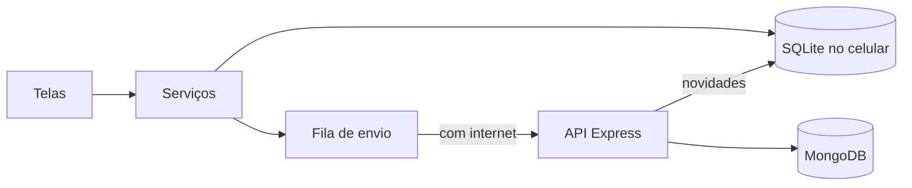

# InfoAbrigo

Aplicativo híbrido que aproxima quem quer ajudar dos abrigos de crianças e adolescentes da região: mostra os abrigos no mapa, o que cada um precisa hoje e como doar, e organiza visitas e entregas numa agenda.

Trabalho da disciplina **Laboratório de Desenvolvimento de Aplicativos Híbridos**, Engenharia de Software, Universidade de Vassouras (2026/2).

## O que tem aqui

| Pasta | O que é |
|---|---|
| `src/` | O aplicativo: React Native com Expo SDK 58, em JavaScript |
| `backend/` | A API REST: Node, Express e MongoDB |
| `__tests__/` | Testes do aplicativo, inclusive sincronização com a API de verdade |
| `backend/test/` | Testes da API |
| `docs/` | Um documento por módulo, com o conceito da aula aplicado e como testar |

## Como rodar

São precisos o [Node.js](https://nodejs.org) 22 ou mais novo e o aplicativo **Expo Go** atualizado no celular.

### Só o aplicativo

Sem servidor, os dados ficam só no celular.

```bash
npm install
```

```bash
npx expo start
```

Abra o QR Code no Expo Go.

### Aplicativo com a API

Num terminal, suba a API com um banco temporário. Não é preciso instalar o MongoDB, mas os dados somem ao fechar:

```bash
cd backend
npm install
npm run dev:memoria
```

Na raiz do projeto, crie o arquivo `.env` a partir do `.env.example` e aponte para o IP do computador. Nunca use `localhost`, porque para o celular `localhost` é ele mesmo. Celular e computador precisam estar na mesma rede:

```
EXPO_PUBLIC_API_URL=http://192.168.0.10:3000
```

Depois, rode `npx expo start` de novo.

Para guardar os dados de verdade, copie `backend/.env.example` para `backend/.env`, preencha `MONGODB_URI` e `JWT_SEGREDO` e use `npm start` no lugar de `npm run dev:memoria`.

## Testes

```bash
npm test
```

```bash
cd backend && npm install && npm test
```

Os testes de sincronização do aplicativo usam a API real, e ficam de fora se `backend/node_modules` não existir.

## Como funciona

As telas leem e gravam no banco SQLite do celular. Cada alteração entra numa fila, que é enviada à API quando há conexão, e o que mudou no servidor volta na mesma rodada. Por isso o aplicativo continua funcionando sem internet.



Quem decide as permissões é o servidor: só o dono altera o abrigo, só quem administra o abrigo marca uma entrega, e doações e agenda são privadas. Os detalhes estão em [docs/modulo-11-servidor-e-banco.md](docs/modulo-11-servidor-e-banco.md).

## Publicação

O passo a passo está em [docs/modulo-12-recursos-nativos-e-publicacao.md](docs/modulo-12-recursos-nativos-e-publicacao.md). Ele cobre o banco no MongoDB Atlas, a API no Render e o aplicativo pelo EAS Build.

## Limites conhecidos

- **Expo Go:** badge, lembretes e o calendário nativo só funcionam no aplicativo instalado por build próprio. No Expo Go o aplicativo abre normalmente, sem badge nem lembrete, e o botão de calendário abre a Agenda do Google.
- **Pagamento:** o aplicativo monta o código Pix, mas quem paga é o banco da pessoa. Nada confere se o pagamento aconteceu.
- **Gestor:** o CNPJ prova que a instituição existe, não que a pessoa trabalha lá. Isso exigiria revisão de documentos.
- **Fotos:** só a foto do abrigo vai para o servidor. As fotos de registro da agenda e a foto de perfil ficam no celular em que foram tiradas.
- **Recuperação de senha:** é feita pela pergunta de segurança, porque a API não envia e-mail.
- **Serviços públicos:** CEP, CNPJ, mapa e rota dependem de serviços gratuitos de terceiros (BrasilAPI, OpenStreetMap, Esri e Valhalla), sem garantia de disponibilidade.
